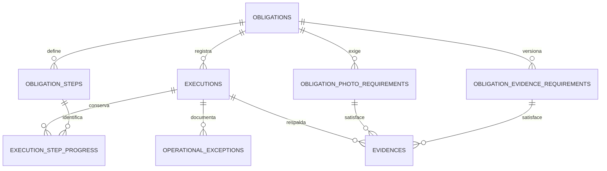

# Flujo del operario: contrato de la primera entrega

Preparación previa por ADMIN: [happy path del administrador](admin-flow.md).

Este documento complementa el [detalle de obligación](obligation-detail.md). Implementa el flujo
online acordado: detalle, inicio, recuperación del avance, fotografías, impedimentos y envío.
Mantiene un centro por cuenta y los permisos existentes. La activación/generación de planes,
las pantallas de login/listado y US-08 no forman parte de este incremento.

## Integración con el trabajo del compañero

La pantalla recibe el ID de la obligación seleccionada y utiliza la sesión existente. No se
modifican las rutas, solicitudes ni implementación del login. El código y formato del listado
`GET /api/v1/obligations` se conservan. Los estados de sus filas son datos que actualiza este
módulo al iniciar, enviar o vencer una obligación.

La cuenta autenticada determina empresa, centro, rol y responsabilidad; el cliente no elige esos
valores. Las escrituras nuevas son exclusivas del operario asignado. Supervisor y administrador
pueden leer dentro de su empresa/centro, sin ejecutar trabajo en nombre del operario.

## Rutas

Todas llevan prefijo `/api/v1` y usan `Authorization: Bearer <token>`.

| Método y ruta | Solicitud | Respuesta |
| --- | --- | --- |
| POST `/obligations/{id}/execution` | Cabecera `Idempotency-Key`; sin cuerpo. | `201` al iniciar; `200` al repetir la misma operación, con la misma ejecución. |
| GET `/obligations/{id}/execution` | Sin cuerpo. | `200`, ejecución actual con todo su avance; `404` si no ha iniciado. |
| GET `/executions/{id}/flow` | Sin cuerpo. | La misma vista completa por ID de ejecución. |
| PUT `/executions/{id}/steps/{stepId}` | `{ completed, expectedVersion }` | Vista completa con el paso actualizado. |
| POST `/executions/{id}/exceptions` | Motivo, descripción, operación y versión; paso opcional. | Vista completa con el impedimento conservado. |
| POST `/executions/{id}/photo-requirements/{requirementId}/photo` | Multipart: `file`, `expectedVersion`; `capturedAt` opcional. | Vista completa tras almacenar realmente el archivo. |
| POST `/executions/{id}/evidence-requirements/{requirementId}/evidence` | Cabecera `Idempotency-Key`. Multipart para PHOTO/SIGNATURE; JSON para QR_CODE/LOCATION. Siempre incluye `capturedAt` y `expectedVersion`. | Evidencia creada o el mismo registro en un replay exacto. |
| POST `/executions/{id}/submit` | Cabecera `Idempotency-Key`; `{ expectedVersion, notes? }` | Vista enviada, validada por el servidor. |
| GET `/evidence/{id}/content` | Sin cuerpo. | Bytes JPEG/PNG privados, con autorización y `Cache-Control: no-store`. |

Los IDs del listado, del detalle y de cada respuesta se reutilizan en la siguiente operación.
No deben sustituirse por IDs fijos ni datos de demostración en las pantallas.

## Happy path completo de endpoints

Este recorrido supone una cuenta `OPERATOR` activa, una obligación asignada dentro de su ventana
`[startsAt, dueAt)` y una definición que materializó requisitos PHOTO, QR_CODE, LOCATION y
SIGNATURE. Una obligación real puede contener solo algunos tipos. El cliente debe leer la respuesta
y ejecutar solamente los requisitos presentes, repitiendo cada tipo hasta alcanzar su
`minimumCount` cuando sea obligatorio.

Los números de los ejemplos son ilustrativos. La aplicación debe guardar los valores reales de
cada respuesta:

```text
BASE_URL       = http://localhost:8080/api/v1
TOKEN          = respuesta de login.token
OBLIGATION_ID  = assigned-obligations.items[].id
EXECUTION_ID   = respuesta de inicio.id
VERSION        = respuesta más reciente de execution.version
STEP_ID        = execution.steps[].id
REQUIREMENT_ID = execution.evidenceRequirements[].id
EVIDENCE_ID    = respuesta de adjunto.id
```

### 1. Iniciar sesión

`identifier` admite el DNI peruano de ocho dígitos o el correo de una cuenta existente.

```bash
curl -X POST "$BASE_URL/auth/login" \
  -H 'Content-Type: application/json' \
  -d '{
    "identifier": "<DNI_O_CORREO>",
    "password": "<CONTRASEÑA>"
  }'
```

Fragmento de respuesta:

```json
{
  "token": "<JWT_ACCESS_TOKEN>",
  "userId": 42,
  "role": "OPERATOR",
  "refreshToken": "<TOKEN_OPACO>"
}
```

Guardar `token` como `TOKEN`. El `refreshToken` no se usa como Bearer ni debe registrarse en logs.

### 2. Seleccionar una obligación asignada

```bash
curl "$BASE_URL/assigned-obligations?status=ASSIGNED&limit=50" \
  -H "Authorization: Bearer $TOKEN"
```

Fragmento de respuesta:

```json
{
  "items": [
    {
      "id": 120,
      "activity": "Inspeccionar recepción",
      "startsAt": "<INSTANTE_ISO_8601>",
      "dueAt": "<INSTANTE_ISO_8601>",
      "status": "ASSIGNED"
    }
  ],
  "hasMore": false
}
```

Guardar el `items[].id` seleccionado como `OBLIGATION_ID`. Si la obligación ya está
`IN_PROGRESS`, recuperar su ejecución con `GET /obligations/{id}/execution` en vez de intentar
crear otra.

### 3. Iniciar o recuperar la ejecución

Crear una clave estable para esta operación y conservarla hasta recibir una respuesta definitiva:

```bash
curl -X POST "$BASE_URL/obligations/$OBLIGATION_ID/execution" \
  -H "Authorization: Bearer $TOKEN" \
  -H 'Idempotency-Key: start-550e8400-e29b-41d4-a716-446655440000'
```

La primera ejecución responde `201`; el replay exacto responde `200`. Fragmento:

```json
{
  "id": 310,
  "obligationId": 120,
  "state": "IN_PROGRESS",
  "version": 0,
  "canEdit": true,
  "steps": [
    { "id": 701, "position": 1, "completed": false }
  ],
  "evidenceRequirements": [
    {
      "id": 801,
      "type": "PHOTO",
      "required": true,
      "minimumCount": 1,
      "maximumCount": 2,
      "constraints": { "requireGeolocation": "true", "maxAgeMinutes": "30" },
      "evidence": []
    },
    {
      "id": 802,
      "type": "QR_CODE",
      "required": true,
      "minimumCount": 1,
      "maximumCount": 1,
      "constraints": { "expectedPrefix": "OPER-" },
      "evidence": []
    }
  ]
}
```

Guardar `id` como `EXECUTION_ID`, `version` como `VERSION`, los IDs de `steps` y el `id` de cada
`evidenceRequirements` por tipo. Para adjuntar se usa el `id` del snapshot de la obligación, no
`sourceRequirementId`.

En cualquier reanudación se puede reconstruir todo el estado con:

```bash
curl "$BASE_URL/executions/$EXECUTION_ID/flow" \
  -H "Authorization: Bearer $TOKEN"
```

### 4. Completar todos los pasos

Enviar un `PUT` por cada paso incompleto. Cada respuesta devuelve la vista completa y una nueva
`version`; esa versión reemplaza a `VERSION` antes del siguiente cambio.

```bash
curl -X PUT "$BASE_URL/executions/$EXECUTION_ID/steps/$STEP_ID" \
  -H "Authorization: Bearer $TOKEN" \
  -H 'Content-Type: application/json' \
  -d "{
    \"completed\": true,
    \"expectedVersion\": $VERSION
  }"
```

No se deben completar pasos en paralelo usando la misma versión. Un `409 VERSION_CONFLICT`
requiere consultar nuevamente `/flow` antes de decidir si se repite el cambio.

### 5. Adjuntar la evidencia requerida

`capturedAt` debe conservar exactamente el mismo valor en un reintento y no puede ser futuro.
Cada adjunto usa una `Idempotency-Key` propia. Un mismo archivo o payload con la misma clave devuelve
el `EVIDENCE_ID` original; cambiar bytes, captura o metadatos con esa clave devuelve
`409 IDEMPOTENCY_KEY_MISMATCH`.

El endpoint de evidencia devuelve `EvidenceView`, no la vista completa de ejecución. Después de
cada adjunto exitoso, consultar `/flow` y sustituir `VERSION` por la versión recibida antes de
adjuntar la evidencia siguiente.

#### PHOTO

Usar geolocalización cuando `constraints.requireGeolocation` sea `true`:

```bash
curl -X POST "$BASE_URL/executions/$EXECUTION_ID/evidence-requirements/$PHOTO_REQUIREMENT_ID/evidence" \
  -H "Authorization: Bearer $TOKEN" \
  -H 'Idempotency-Key: evidence-photo-550e8400-e29b-41d4-a716-446655440001' \
  -F 'file=@/ruta/absoluta/foto.png;type=image/png' \
  -F "expectedVersion=$VERSION" \
  -F 'capturedAt=<INSTANTE_ISO_8601>' \
  -F 'latitude=-12.046374' \
  -F 'longitude=-77.042793' \
  -F 'accuracyMeters=8.5'
```

Fragmento de respuesta:

```json
{
  "id": 901,
  "evidenceRequirementId": 801,
  "type": "PHOTO",
  "checksum": "<SHA_256>",
  "capturedAt": "<INSTANTE_ISO_8601>",
  "contentPath": "/api/v1/evidence/901/content"
}
```

Guardar `id` como `EVIDENCE_ID` y `contentPath` para la descarga autenticada.

#### QR_CODE

El valor debe respetar `constraints.expectedPrefix` cuando exista:

```bash
curl -X POST "$BASE_URL/executions/$EXECUTION_ID/evidence-requirements/$QR_REQUIREMENT_ID/evidence" \
  -H "Authorization: Bearer $TOKEN" \
  -H 'Idempotency-Key: evidence-qr-550e8400-e29b-41d4-a716-446655440002' \
  -H 'Content-Type: application/json' \
  -d "{
    \"textValue\": \"OPER-12345\",
    \"capturedAt\": \"<INSTANTE_ISO_8601>\",
    \"expectedVersion\": $VERSION
  }"
```

#### LOCATION

La precisión debe ser positiva y no superar `constraints.maxAccuracyMeters`:

```bash
curl -X POST "$BASE_URL/executions/$EXECUTION_ID/evidence-requirements/$LOCATION_REQUIREMENT_ID/evidence" \
  -H "Authorization: Bearer $TOKEN" \
  -H 'Idempotency-Key: evidence-location-550e8400-e29b-41d4-a716-446655440003' \
  -H 'Content-Type: application/json' \
  -d "{
    \"latitude\": -12.046374,
    \"longitude\": -77.042793,
    \"accuracyMeters\": 8.5,
    \"capturedAt\": \"<INSTANTE_ISO_8601>\",
    \"expectedVersion\": $VERSION
  }"
```

#### SIGNATURE

SIGNATURE usa multipart como PHOTO, pero acepta solamente PNG hasta 1 MiB. No se envían
coordenadas salvo que la regla futura las exija explícitamente.

```bash
curl -X POST "$BASE_URL/executions/$EXECUTION_ID/evidence-requirements/$SIGNATURE_REQUIREMENT_ID/evidence" \
  -H "Authorization: Bearer $TOKEN" \
  -H 'Idempotency-Key: evidence-signature-550e8400-e29b-41d4-a716-446655440004' \
  -F 'file=@/ruta/absoluta/firma.png;type=image/png' \
  -F "expectedVersion=$VERSION" \
  -F 'capturedAt=<INSTANTE_ISO_8601>'
```

### 6. Revisar el estado consolidado

Después del último paso o evidencia, consultar siempre la vista autoritativa:

```bash
curl "$BASE_URL/executions/$EXECUTION_ID/flow" \
  -H "Authorization: Bearer $TOKEN"
```

Antes de enviar se debe comprobar:

- todos los elementos de `steps` tienen `completed: true`;
- cada requisito `required` contiene al menos `minimumCount` elementos en `evidence`;
- la cantidad nunca supera `maximumCount`;
- `state` sigue siendo `IN_PROGRESS` y `canEdit` es `true`;
- `VERSION` se actualiza con el `version` de esta respuesta.

Los requisitos opcionales pueden permanecer con `evidence: []`.

### 7. Enviar la ejecución

```bash
curl -X POST "$BASE_URL/executions/$EXECUTION_ID/submit" \
  -H "Authorization: Bearer $TOKEN" \
  -H 'Idempotency-Key: submit-550e8400-e29b-41d4-a716-446655440005' \
  -H 'Content-Type: application/json' \
  -d "{
    \"expectedVersion\": $VERSION,
    \"notes\": \"Ejecución completada desde la aplicación móvil\"
  }"
```

Fragmento de respuesta feliz:

```json
{
  "id": 310,
  "state": "SUBMITTED",
  "obligationStatus": "SUBMITTED",
  "result": "COMPLETED",
  "canEdit": false,
  "submittedAt": "<INSTANTE_DEL_SERVIDOR>",
  "version": 6
}
```

Conservar la misma clave y el mismo contenido hasta recibir la respuesta. El replay exacto devuelve
la misma ejecución; no se crea otra ni se reabre la enviada.

### 8. Consultar un archivo privado

PHOTO y SIGNATURE entregan `contentPath`. Se descarga siempre mediante la API autenticada:

```bash
curl "$BASE_URL/evidence/$EVIDENCE_ID/content" \
  -H "Authorization: Bearer $TOKEN" \
  --output evidencia.png
```

No se construye una URL de Supabase ni se persiste `storageKey` en Kotlin. La descarga puede
realizarse antes o después del envío mientras el usuario conserve el alcance autorizado.

## Vista de ejecución

Incluye `id`, `obligationId`, `operatorId`, `state`, `obligationStatus`, `result`,
`startedAt`, `submittedAt`, `startsAt`, `dueAt`, `timezone`, `version`, `canEdit`,
`notes`, `steps`, `photoRequirements`, `evidenceRequirements` y `exceptions`.

- Cada paso conserva su ID, título, instrucciones, posición, `completed` y `updatedAt`.
- Cada requisito fotográfico conserva su ID, título, descripción y posición; agrega
  `evidenceId`, `uploadedAt` y `contentPath` solamente cuando existe un archivo registrado.
- Cada requisito versionado indica ID, requisito fuente, tipo, obligatoriedad, mínimo, máximo,
  posición, restricciones y su lista inmutable de evidencias. Los archivos muestran una ruta
  protegida; QR y ubicación muestran solo datos estructurados y metadatos de auditoría.
- Cada impedimento incluye ID, paso opcional, motivo, descripción, actor, fecha, `operationId`
  y los `evidenceIds` inmutables que se vincularon al registrarlo.
- Nunca se devuelve la clave del almacenamiento ni su ruta interna. `contentPath` es una ruta
  protegida de nuestra API, no una URL pública del proveedor.
- En curso, `result` es `null`. El operario no selecciona ni envía un estado de resultado.

## Estados y tiempo

| Estado de obligación | Significado para la app |
| --- | --- |
| ASSIGNED | Asignada, sin iniciar. |
| IN_PROGRESS | En curso; el progreso puede ser parcial. |
| SUBMITTED | Ejecución completada y enviada; evaluación de cumplimiento todavía no determinada. |
| OVERDUE | Vencida; edición bloqueada. |

La ejecución nueva tiene estados `IN_PROGRESS` y `SUBMITTED`, separados del estado de la
obligación y de cualquier Compliance Result. `LEGACY` identifica exclusivamente registros del
contrato anterior. No hay un estado manual `PARTIAL` en el flujo nuevo: se muestra el avance
mientras sigue en curso.

La ventana es `[startsAt, dueAt)`: incluye el inicio y excluye exactamente la hora límite.
La autoridad es el reloj del servidor; las fechas son instantes y la presentación es
`America/Lima`. Una obligación enviada a tiempo no vence posteriormente.

Las consultas del detalle/flujo derivan el vencimiento inmediatamente. Un proceso periódico
actualiza también el estado persistido de las obligaciones configuradas pendientes/en curso,
sin modificar el código del listado. El intervalo predeterminado es 30 segundos, configurable
mediante `app.field-operations.expiry-delay-ms`; no determina el permiso de edición. Cada
comando comprueba el límite exacto por su cuenta. `app.field-operations.expiry-enabled=false`
deshabilita solamente ese proceso periódico, como ocurre en las pruebas con reloj controlado.

El servidor valida y registra cada acción usando el mismo instante. Una subida que termina fuera
del plazo no se confirma como evidencia y se intenta eliminar su objeto privado al revertir la
transacción. No se reabre una ejecución ni se concede una ampliación de plazo automáticamente.

## Inicio, progreso y concurrencia

- Inicio, impedimentos y envío requieren una `Idempotency-Key` de 8 a 100 caracteres alfanuméricos o
  `. _ : -`. La clave se limita por empresa, operario y comando durante siete días.
- En inicio, la obligación forma el contenido semántico; en envío lo forman la ejecución y las
  notas normalizadas. `expectedVersion` no forma parte de ese contenido. El mismo contenido
  devuelve la ejecución original; cambiarlo con la misma clave devuelve
  `IDEMPOTENCY_KEY_MISMATCH`.
- Se crea una única ejecución por obligación configurada. Los reintentos devuelven su identidad
  y progreso existentes; no reinician ni duplican los pasos.
- Los pasos pueden marcarse y desmarcarse mientras la ejecución esté abierta y dentro del plazo.
- `version` es la versión persistida de la ejecución. Toda escritura usa `expectedVersion`
  de la última vista recibida, nunca una constante.
- Un cambio desactualizado devuelve `409 VERSION_CONFLICT` y `currentVersion`. Se vuelve a
  consultar antes de decidir repetirlo. No hay sobrescritura silenciosa.
- Las operaciones se serializan mediante un bloqueo de la obligación y mantienen la versión
  optimista de la ejecución. Una restricción PostgreSQL impide duplicar ejecuciones nuevas.
- Repetir un paso que ya tiene ese valor devuelve la vista actual sin otra modificación.

## Impedimentos: US-07

Ejemplo ilustrativo; los IDs, la versión y UUID deben proceder del flujo real:

```json
{
  "reason": "AREA_CLOSED",
  "description": "La puerta de acceso está cerrada con llave.",
  "stepId": 123,
  "operationId": "aaaaaaaa-aaaa-4aaa-8aaa-aaaaaaaaaaaa",
  "evidenceIds": [456],
  "expectedVersion": 2
}
```

```bash
curl -X POST "$BASE_URL/executions/$EXECUTION_ID/exceptions" \
  -H "Authorization: Bearer $TOKEN" \
  -H "Idempotency-Key: exception-aaaaaaaa" \
  -H "Content-Type: application/json" \
  --data @exception.json
```

Los motivos permitidos corresponden a los mockups: `AREA_CLOSED`, `MISSING_SUPPLIES`,
`SAFETY_RISK`, `OTHER`. La descripción es obligatoria, de hasta 2000 caracteres.
Sin `stepId`, el impedimento corresponde a la obligación completa; si se indica, debe ser
un paso de esa obligación. `evidenceIds` es opcional y solo acepta evidencias ya registradas en
esa misma ejecución; no admite duplicados, IDs inexistentes ni evidencias de otra ejecución.

`Idempotency-Key` conserva el resultado durante siete días bajo empresa, operario y comando.
`operationId` continúa como UUID estable del cliente y evita duplicar el mismo registro dentro de
la ejecución. El mismo contenido normalizado devuelve la ejecución con el impedimento original;
un cambio de contenido con la misma clave o UUID devuelve `IDEMPOTENCY_KEY_MISMATCH`.
`expectedVersion` no forma parte del contenido semántico.

El impedimento no completa la obligación, no exime fotografías o pasos, no bloquea la posibilidad
de continuar antes del límite y no genera una evaluación de cumplimiento. Permanece en el
historial aunque el operario consiga después completar y enviar la ejecución. Mientras no se
envíe, la ejecución conserva `IN_PROGRESS`; la presencia de `exceptions` es la señal revisable.

## Evidencia requerida: US-06

- La generación copia todas las reglas PHOTO, QR_CODE, LOCATION y SIGNATURE a la obligación.
  La copia mantiene el requisito fuente y la versión de definición de la obligación; una edición
  posterior de Service Planning no cambia trabajo ya materializado.
- Cada adjunto exige `Idempotency-Key` durante siete días. El contenido semántico incluye
  ejecución, requisito, captura y archivo/datos normalizados, pero no `expectedVersion`. Un replay
  exacto devuelve el mismo ID sin otra escritura; cambiar el contenido produce
  `409 IDEMPOTENCY_KEY_MISMATCH`.
- PHOTO admite JPEG/PNG de hasta 5 MiB y 25 millones de píxeles. SIGNATURE admite solamente PNG
  de hasta 1 MiB. Ambos se guardan de forma privada y nunca devuelven `storageKey`.
- QR_CODE admite 1–512 caracteres y respeta `expectedPrefix`. LOCATION exige latitud `[-90,90]`,
  longitud `[-180,180]`, precisión positiva y `maxAccuracyMeters`. PHOTO respeta
  `requireGeolocation` y `maxAgeMinutes` cuando la regla los declara.
- La evidencia no se reemplaza ni se elimina automáticamente en V1. Se impide superar
  `maximumCount`. Al enviar, solo un requisito `required` por debajo de `minimumCount` bloquea;
  requisitos opcionales ausentes no bloquean.
- La descarga revalida empresa, centro, ejecución y propietario. Administrador/supervisor pueden
  leer dentro de su alcance y el operario solo su propia ejecución.

### Compatibilidad fotográfica anterior

- Cada requisito admite una única fotografía. Un nuevo archivo diferente no puede reemplazarla.
- Un reintento con los mismos bytes conserva el registro original, sus metadatos y fecha; no
  vuelve a subir el archivo. Los reintentos de una operación ya realizada no reabren la ejecución.
- Se admiten JPEG y PNG reales, de hasta 5 MiB (5 × 1024 × 1024 bytes). Se comprueban el contenido,
  el tipo declarado y que se pueda decodificar. Como límite técnico de memoria, no se admiten
  imágenes de más de 25 millones de píxeles.
- `capturedAt` es opcional y representa la fecha declarada por el dispositivo, no una fecha
  verificada de captura. No puede ser futura respecto al servidor. `uploadedAt` es independiente
  y lo registra el servidor.
- El requisito debe pertenecer a la obligación ejecutada. Tener una URL o enviar un ID ajeno
  no satisface ningún requisito.
- Si falla el proveedor o la base de datos, no se confirma el registro como exitoso. Se compensa
  un rollback eliminando el objeto nuevo. Ante un estado transaccional desconocido se conserva
  el archivo para reconciliación en lugar de arriesgar eliminar una evidencia comprometida.
- La descarga comprueba nuevamente los permisos y el SHA-256 almacenado. No expone el archivo si
  su integridad no coincide. Las respuestas del proveedor tienen límite de tamaño y tiempo.
- Una obligación configurada explícitamente sin fotografías no exige fotos; sigue exigiendo sus pasos.

### Configuración privada

El adaptador usa Supabase Storage sin sustituir nuestra API, autenticación ni la base PostgreSQL
que ya tiene el grupo. La cuenta, bucket y credenciales reales aún deben identificarse/configurarse.

| Variable de entorno del backend | Valor esperado |
| --- | --- |
| FIELD_PHOTO_STORAGE_URL | URL HTTPS del proyecto, sin sufijo `/storage/v1`. |
| FIELD_PHOTO_STORAGE_SERVICE_KEY | Clave `service_role` de servidor; nunca incluirla en Android ni en Git. |
| FIELD_PHOTO_STORAGE_BUCKET | Nombre del bucket existente y privado. |

El código no crea una base nueva, buckets ni permisos externos. Antes de subir o descargar
comprueba que el bucket no sea público. Sin configuración válida o con el proveedor inaccesible
devuelve `503 PHOTO_STORAGE_UNAVAILABLE`; no guarda una evidencia ficticia. HTTP sin TLS se
admite únicamente contra `127.0.0.1` para las pruebas del adaptador.

La integración sigue los contratos oficiales de
[upload](https://supabase.com/docs/reference/self-hosting-storage/upload-a-new-object),
[descarga privada](https://supabase.com/docs/guides/storage/serving/downloads) y
[buckets privados](https://supabase.com/docs/guides/storage/buckets/fundamentals).
Los endpoints privados usan exclusivamente credenciales de servidor y no siguen redirecciones.

## Envío explícito

`POST /executions/{id}/submit` exige todos los pasos marcados, todas las fotos legacy exigidas
registradas y los mínimos de cada requisito versionado obligatorio. Los requisitos opcionales
no impiden el envío. También exige versión vigente y plazo abierto. `notes` es opcional y admite hasta 2000 caracteres.
No recibe un resultado elegido por el operario.

Solo al superar esas validaciones registra `submittedAt`, establece `result=COMPLETED` y
cambia ejecución y obligación a `SUBMITTED` en la misma transacción. A partir de entonces
no se pueden modificar los pasos, fotografías o impedimentos. Repetir el mismo envío devuelve
el registro enviado; cambiar sus notas después del envío devuelve conflicto.

`COMPLETED` expresa que se completó este registro operativo. No demuestra limpieza física
automática, validez jurídica, protocolo verificado, nitidez, ni aprobación del supervisor.

## Compatibilidad y errores

Los registros anteriores se conservan como `LEGACY`, sin inventar fechas de inicio/envío.
Los endpoints antiguos continúan disponibles para sus obligaciones antiguas no configuradas.
En las configuradas se rechaza el POST antiguo de resultado con
`EXECUTION_LIFECYCLE_REQUIRED`, y en las ejecuciones nuevas se rechaza el POST de URLs con
`PHOTO_UPLOAD_REQUIRED`. Así no pueden usarse para saltarse pasos/fotos.

El cliente del flujo nuevo debe migrar inicio y envío para incluir `Idempotency-Key`. Omitirla
devuelve `400 VALIDATION_ERROR`. El endpoint legacy `POST /api/v1/executions` no cambia.

Si una obligación tiene registros históricos, el flujo nuevo devuelve `LEGACY_EXECUTION`;
no crea otra ejecución ni reinterpreta un historial ambiguo. Para esta entrega se preparan
obligaciones nuevas con su configuración explícita.

Se conserva `ApiError` y los códigos 400/401/403/404. Los conflictos 409 incluyen:
`EXECUTION_NOT_CONFIGURED`, `EXECUTION_NOT_STARTED_YET`, `OBLIGATION_OVERDUE`,
`INVALID_EXECUTION_STATE`, `EXECUTION_ALREADY_SUBMITTED`, `VERSION_CONFLICT`,
`PHOTO_ALREADY_ATTACHED`, `EVIDENCE_LIMIT_REACHED`, `IDEMPOTENCY_KEY_MISMATCH` y los de compatibilidad anteriores.
Una ejecución incompleta devuelve `400 VALIDATION_ERROR` con `details.steps` y/o
`details.photoRequirements`. Parámetros multipart ausentes o mal formados devuelven
`400 INVALID_REQUEST`; una carga que supera el límite del servidor devuelve
`413 PHOTO_TOO_LARGE`. Almacenamiento ausente, inválido o con contenido corrupto devuelve 503.

## Persistencia y verificación

V11 conserva los datos históricos y agrega ciclo/versión a `executions`,
`execution_step_progress`, `operational_exceptions` y metadatos privados en `evidences`.
No cambia V1–V10, usuarios, pertenencias a centros ni las tablas de Service Planning.
V16 agrega referencias idempotentes de siete días para inicio y envío. V17 agrega snapshots,
datos estructurados y referencias idempotentes de evidencia. V18 conserva el checksum histórico
de V17 y agrega los límites fuertes de tipo/contenido, independencia del snapshot y obligatoriedad
de su referencia fuente. La referencia idempotente desaparece si se elimina su evidencia.



La multiplicidad histórica de ejecuciones se conserva; el índice parcial de V11 limita a una
única ejecución nueva por obligación. El registro de impedimentos no tiene ninguna relación
de creación automática con Compliance Results.

Comprobaciones locales con Java 17:

```cmd
gradlew.bat build --no-daemon
gradlew.bat test --no-daemon --tests com.api.servicecompliance.OperatorFlowIntegrationTests --tests com.api.servicecompliance.SupabasePhotoStorageTests
```

Las pruebas del flujo usan reloj controlado y almacenamiento en memoria **solo en pruebas**.
Las del adaptador usan un servidor HTTP local. Ninguna de esas pruebas demuestra una conexión
real a Supabase. No hay almacenamiento ficticio como alternativa de producción.

Las suites de migración PostgreSQL son opt-in para una base temporal local exclusiva:
`FIELD_OPERATIONS_TEST_JDBC_URL=jdbc:postgresql://127.0.0.1:55439/field_operations_test`,
usuario mediante `FIELD_OPERATIONS_TEST_DB_USER` y contraseña, si existe, mediante
`FIELD_OPERATIONS_TEST_DB_PASSWORD`. Crean esquemas separados y rechazan una URL remota.
Se deben comprobar instalación vacía, actualización con historial, integridad, acceso y concurrencia.

Antes de aplicar V10/V11 a la instancia compartida, el grupo debe identificarla y comprobar
migraciones, respaldo y configuración. La puesta en marcha real de fotos requiere el bucket
privado configurado. Kotlin se validará posteriormente con Run de Android Studio; US-08 sigue
pendiente. El informe académico deberá reflejar este alcance y las nuevas relaciones.

### Resultado de verificación local (2026-11-05)

- Java 17 y Gradle Wrapper 9.7.1: `gradlew.bat build --no-daemon` correcto, con 69 pruebas
  ejecutadas sin fallos. Cuatro pruebas de migración quedan omitidas en esa ejecución por
  requerir el PostgreSQL local opt-in.
- PostgreSQL 18.4 temporal y exclusivo de pruebas: 38 pruebas seleccionadas sin fallos,
  con Flyway habilitado y Hibernate en modo `validate`. Incluyen detalle, flujo completo,
  concurrencia, fechas límite, preservación de datos de V9/V10, restricciones V10/V11 y el
  adaptador HTTP local. No se probó una instancia PostgreSQL 16 ni el despliegue compartido.
- El servidor temporal se detuvo al terminar. No se creó ni modificó infraestructura externa.
- La comparación de contenidos confirmó intactos autenticación, Service Planning, controlador
  de obligaciones, método y respuesta del listado, dependencias y migraciones V1–V10. El
  servicio de detalle solo agrega el reloj para reflejar vencimiento inmediatamente; no cambia
  el listado. No se ejecutaron comandos Git.
- Las credenciales y el bucket real no estuvieron disponibles: la prueba contra Supabase real
  y la aplicación coordinada de V10/V11 en la base del grupo siguen pendientes. El adaptador
  está implementado y comprobado contra su contrato HTTP local, no contra una cuenta real.

Comando PostgreSQL ejecutado, con las variables anteriores apuntando exclusivamente al clúster
local y las variables de Spring Datasource/Flyway dirigidas a esa misma base temporal:

```cmd
gradlew.bat test --no-daemon --rerun-tasks --tests com.api.servicecompliance.OperatorFlowIntegrationTests --tests com.api.servicecompliance.OperatorFlowMigrationTests --tests com.api.servicecompliance.ObligationDetailsIntegrationTests --tests com.api.servicecompliance.ObligationDetailsMigrationTests --tests com.api.servicecompliance.SupabasePhotoStorageTests
```

### Resultado de verificación BE-US-06 (2026-11-16)

- Java 17: suite H2 completa con 103 pruebas, 95 ejecutadas correctamente y 8 migraciones opt-in
  omitidas por configuración.
- PostgreSQL 16 local: 25/25 pruebas HTTP del flujo con Flyway V1–V18 y Hibernate `validate`;
  5/5 pruebas enfocadas de migración, restricciones, unicidad y cascada.
- Se usaron bases exclusivas creadas en el servidor local ya activo y se eliminaron al terminar.
  No se inició Docker ni se modificó la base persistente `service_compliance`.
- El almacenamiento de prueba fue en memoria. No se usaron credenciales de un proyecto Supabase,
  por lo que la integración real con ese proveedor permanece como verificación de entorno.

## Archivos de esta continuación

Rutas relativas al backend; los paquetes Java parten de
`src/main/java/com/api/servicecompliance/`:

- `executions/application/FieldExecutionService.java`: ciclo, permisos, avance, envío y consistencia.
- `executions/application/ExecutionService.java`: impide saltar el flujo nuevo por el POST antiguo.
- `executions/application/EvidenceService.java`: impide sustituir la subida por una URL declarada.
- `executions/application/PhotoStorage.java`, `PhotoStorageUnavailableException.java`, `PhotoValidator.java`.
- `executions/domain/model/Execution.java`, `ExecutionState.java`, `ExecutionStepProgress.java`.
- `executions/domain/model/Evidence.java`, `OperationalException.java`, `ExceptionReason.java`.
- `executions/domain/repository/ExecutionRepository.java`, `EvidenceRepository.java`,
  `ExecutionStepProgressRepository.java`, `OperationalExceptionRepository.java`.
- `executions/infrastructure/FieldOperationsConfiguration.java`, `ObligationExpiryJob.java`,
  `SupabasePhotoStorage.java`.
- `executions/interfaces/rest/FieldOperationController.java`: endpoints separados del login/listado.
- `obligations/domain/model/Obligation.java`, `obligations/domain/repository/ObligationRepository.java`.
- `obligations/application/ObligationService.java`: reloj únicamente para el detalle/creación.
- `shared/web/GlobalExceptionHandler.java`: errores controlados de multipart y almacenamiento.
- `src/main/resources/application.properties`: configuración privada y límites multipart.
- `src/main/resources/db/migration/V11__add_operator_execution_flow.sql`.
- `src/main/resources/db/migration/V17__add_required_evidence_contract.sql`.
- `src/main/resources/db/migration/V18__strengthen_required_evidence_integrity.sql`.
- `src/test/java/com/api/servicecompliance/OperatorFlowIntegrationTests.java`,
  `OperatorFlowMigrationTests.java`, `SupabasePhotoStorageTests.java`.
- `src/test/java/com/api/servicecompliance/ObligationDetailsMigrationTests.java`: fija la prueba
  original de V10 a esa versión para conservar su propósito al agregar V11.
- `README.md`, `docs/backlog/contracts.md`, `docs/field-operations/obligation-detail.md`
  y este documento.
